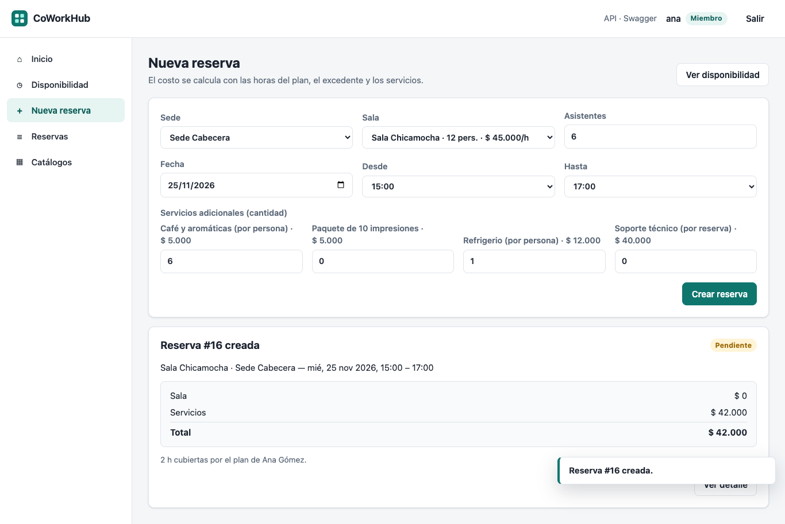

# CoWorkHub

Aplicación web para gestionar una red de coworking: sedes, salas, planes de membresía, miembros,
disponibilidad y reservas. Evita las reservas duplicadas (incluso si llegan dos a la vez),
controla las horas que consume cada miembro, cobra las cancelaciones con una sola regla y limita
a cada usuario a lo que le corresponde según su rol.

Tiene dos partes que arrancan juntas con un solo comando:

- **Backend**: API REST con Spring Boot, MySQL y seguridad JWT.
- **Frontend**: interfaz web en HTML, CSS y JavaScript que consume esa API.

| | |
|---|---|
| Frontend | <http://localhost:8080/> |
| Swagger UI | <http://localhost:8080/doc/swagger-ui.html> |
| Documento OpenAPI | <http://localhost:8080/v3/api-docs> (copia en [`docs/openapi.json`](docs/openapi.json)) |
| Salud | <http://localhost:8080/actuator/health> |
| Análisis | [`docs/analisis.md`](docs/analisis.md): casos de uso, glosario, diagrama ER, trazabilidad y decisiones |
| Evidencias | [`docs/evidencias/`](docs/evidencias) y [`docs/resultados-pruebas.md`](docs/resultados-pruebas.md) |

---

## 1. Integrantes

| Nombre | GitHub | Rol en el proyecto |
|---|---|---|
| Nicolás | [@isnowyy](https://github.com/isnowyy) | Análisis, backend, frontend y pruebas (trabajo individual) |

## 2. Tecnologías utilizadas

| Capa | Tecnología |
|---|---|
| Lenguaje y build | Java 21 · Maven 3.9 (incluye `./mvnw`) |
| Framework | Spring Boot 4.1.2: Web MVC, Data JPA (Hibernate 7), Validation, Security, Actuator |
| Base de datos | MySQL 8 con el conector `mysql-connector-j` |
| Seguridad | Spring Security, JWT con jjwt 0.12.6 (HS512, 60 min) y contraseñas con BCrypt |
| Documentación de la API | springdoc-openapi 3 (Swagger UI) |
| Frontend | HTML5, CSS3 y JavaScript (módulos ES), sin librerías ni compilación |
| Pruebas | JUnit 5 (`mvn test`), script de aceptación en Python 3 y colección de Postman/Insomnia |
| Contenedores (opcional) | Docker para MySQL |

## 3. Requisitos previos

- **Java 21** o superior (`java -version`).
- **Maven 3.9**, o el `./mvnw` incluido, que no necesita instalar Maven.
- **MySQL 8**: instalado en el equipo o con **Docker**.
- Un navegador moderno (Chrome, Edge, Firefox o Safari) para el frontend.
- **Python 3**, solo para correr el script de pruebas de aceptación.

## 4. Instalación

```bash
git clone https://github.com/isnowyy/coworkhub.git
```

```bash
cd coworkhub
```

Después prepara MySQL (sección 5) y ejecuta el proyecto (sección 7). No hay que instalar nada
para el frontend: Spring Boot lo sirve junto con la API.

## 5. Preparar MySQL

Por defecto, la aplicación usa la misma configuración del enunciado: MySQL en
**`localhost:3306`**, base `coworkhub`, usuario `coworkhub` y contraseña `coworkhub`. Si tu MySQL
está en otro puerto o tiene otras credenciales, no hay que tocar el código: se indican con
variables de entorno (sección 6). Si la base no existe y el usuario tiene permiso, la aplicación
la crea al arrancar.

### Opción A — Con Docker (recomendada)

```bash
docker run -d --name coworkhub-mysql \
  -e MYSQL_DATABASE=coworkhub \
  -e MYSQL_USER=coworkhub \
  -e MYSQL_PASSWORD=coworkhub \
  -e MYSQL_ROOT_PASSWORD=root \
  -p 3306:3306 \
  -v coworkhub-datos:/var/lib/mysql \
  mysql:8.4
```

En Windows escríbelo en una sola línea, sin las `\`. La primera vez tarda unos segundos: espera
a que `docker logs coworkhub-mysql` muestre `ready for connections`.

- **Si ya tienes un contenedor `coworkhub-mysql`** (el error dice *The container name is already
  in use*), no lo crees otra vez: inícialo con `docker start coworkhub-mysql`.
- **Si el puerto 3306 está ocupado** (por ejemplo, por un MySQL instalado), publícalo en otro
  puerto con `-p 3307:3306` y arranca la aplicación con `COWORKHUB_DB_PORT=3307` (sección 6).

| Para… | Comando |
|---|---|
| Ver si está corriendo | `docker ps` |
| Detenerlo / iniciarlo | `docker stop coworkhub-mysql` · `docker start coworkhub-mysql` |
| Abrir la consola de MySQL | `docker exec -it coworkhub-mysql mysql -u coworkhub -pcoworkhub coworkhub` |
| Borrarlo con sus datos | `docker rm -f coworkhub-mysql` y `docker volume rm coworkhub-datos` |

### Opción B — Con MySQL instalado

Como `root`, crea la base y el usuario:

```sql
CREATE DATABASE coworkhub CHARACTER SET utf8mb4 COLLATE utf8mb4_0900_ai_ci;
CREATE USER 'coworkhub'@'localhost' IDENTIFIED BY 'coworkhub';
GRANT ALL PRIVILEGES ON coworkhub.* TO 'coworkhub'@'localhost';
FLUSH PRIVILEGES;
```

Si tu MySQL está en otro puerto o prefieres usar otro usuario (por ejemplo `root`), indícalo
con las variables de la sección 6.

### Tablas y datos de prueba

No hace falta crear las tablas: al arrancar, Hibernate las crea a partir de las entidades y
carga [`src/main/resources/import.sql`](src/main/resources/import.sql) (`ddl-auto=create`:
**cada arranque empieza de cero** con los mismos datos).

Para preparar o revisar la base **sin arrancar la aplicación**, está
[`src/main/resources/migracion.sql`](src/main/resources/migracion.sql): crea las 10 tablas
(con sus claves, índices y restricciones) y carga los mismos datos de prueba.

```bash
docker exec -i coworkhub-mysql mysql -u coworkhub -pcoworkhub coworkhub < src/main/resources/migracion.sql
```

Con MySQL instalado: `mysql -u coworkhub -p coworkhub < src/main/resources/migracion.sql`.

## 6. Configuración mediante variables de entorno

Todo tiene un valor por defecto para que el proyecto arranque sin configurar nada. Para cambiarlo
sin tocar el código:

| Variable | Por defecto | Para qué |
|---|---|---|
| `COWORKHUB_DB_HOST` | `localhost` | Servidor de MySQL |
| `COWORKHUB_DB_PORT` | `3306` | Puerto de MySQL |
| `COWORKHUB_DB_NAME` | `coworkhub` | Nombre de la base (se crea si no existe) |
| `COWORKHUB_DB_USER` | `coworkhub` | Usuario de la base |
| `COWORKHUB_DB_PASSWORD` | `coworkhub` | Contraseña de la base |
| `COWORKHUB_JWT_SECRETO` | clave educativa del archivo | Clave de firma de los JWT (mínimo 32 caracteres) |
| `SERVER_PORT` | `8080` | Puerto de la aplicación, si el 8080 está ocupado |

macOS o Linux:

```bash
COWORKHUB_DB_PORT=3307 mvn spring-boot:run
```

Windows (PowerShell):

```powershell
$env:COWORKHUB_DB_PORT="3307"; mvn spring-boot:run
```

Windows (CMD): `set COWORKHUB_DB_PORT=3307` y después `mvn spring-boot:run`.

La URL de conexión incluye `connectionTimeZone=LOCAL&forceConnectionTimeZoneToSession=true`: así
MySQL usa la zona horaria del equipo y `CURDATE()` (que usa `import.sql`) da la misma fecha que la
aplicación, también de noche, cuando en UTC ya es el día siguiente.

## 7. Ejecución del backend y del frontend

### Backend y frontend (un solo comando)

Con MySQL corriendo, desde la carpeta del proyecto:

```bash
mvn spring-boot:run
```

O sin Maven instalado: `./mvnw spring-boot:run` (en Windows, `mvnw.cmd spring-boot:run`).

Cuando el log diga `Started Main`:

1. **Frontend**: abre <http://localhost:8080/> e inicia sesión con un usuario de prueba
   (sección 9). En la pantalla de inicio hay botones con cada usuario para entrar con un clic.
2. **API**: <http://localhost:8080/doc/swagger-ui.html> (sección 10).

El frontend está en [`src/main/resources/static`](src/main/resources/static) y Spring Boot lo
sirve en `/`. Como la página y la API están en el mismo origen, no hace falta CORS ni otro
servidor. Si cambias un archivo del frontend, recarga el navegador después de volver a arrancar
(o de `mvn process-resources`).

| Sección del frontend | Quién la ve | Qué hace |
|---|---|---|
| Inicio | Todos | Miembro: consumo del mes (horas incluidas, usadas, restantes y excedentes) y próximas reservas. Personal: resumen y reservas por confirmar |
| Disponibilidad | Todos | Salas libres de una sede por fecha, horario, capacidad y equipamiento |
| Nueva reserva | Todos | Crea la reserva con sus servicios y muestra el costo calculado. El personal elige el miembro |
| Reservas | Todos | Miembro: solo las suyas. Personal: filtro por estado, miembro o sala y fecha. Detalle con servicios, cancelar, confirmar y completar |
| Miembros | `ADMIN`, `RECEPTIONIST` | Registrar miembro y cuenta, editar, suspender, activar, eliminar y ver el consumo |
| Catálogos | Todos (solo `ADMIN` edita) | Sedes, salas (con equipamiento), equipamiento, servicios adicionales y planes |

Los errores de la API se muestran en un aviso con su mensaje y su código (por ejemplo,
`HTTP 409 RN-01`). Si el token vence, el frontend vuelve a la pantalla de inicio de sesión.

### Reloj fijo (para repetir las pruebas)

Las reglas de anticipación (RN-03 y RN-08) dependen de la hora actual. Para que las pruebas den
siempre lo mismo, el "ahora" de la aplicación se puede congelar:

```bash
mvn spring-boot:run -Dspring-boot.run.arguments=--coworkhub.reloj.fijo=08:00
```

`08:00` significa **hoy a las 8:00** (las fechas de `import.sql` también son relativas a hoy).
También acepta una fecha completa, por ejemplo `2030-06-03T08:00:00`. Sin el parámetro, usa la
hora real.

### Ejecutarlo en otro computador

Lista de verificación para revisar el proyecto en un equipo nuevo:

1. `java -version` muestra **21 o superior**. Maven es opcional: el proyecto trae `./mvnw`
   (`mvnw.cmd` en Windows), que descarga Maven la primera vez. Hace falta internet la primera vez
   para bajar las dependencias.
2. MySQL 8 está corriendo en el puerto 3306 con la base y el usuario `coworkhub` (sección 5). Si
   está en otro puerto o con otro usuario, usa las variables de la sección 6.
3. El puerto 8080 está libre. Si no, arranca con `SERVER_PORT=8081` y abre <http://localhost:8081/>.
4. Desde la carpeta del proyecto: `mvn spring-boot:run` (o `./mvnw spring-boot:run`).
5. Abre <http://localhost:8080/> e inicia sesión con un usuario de prueba.

La base se reinicia en cada arranque (`ddl-auto=create`): borra y vuelve a crear **sus** tablas
(`locations`, `rooms`…) y carga los datos de prueba. Si en la misma base hay tablas de otro
proyecto con esos nombres, usa una base aparte, por ejemplo con `COWORKHUB_DB_NAME=coworkhub_nicolas`
(si el usuario no tiene permiso para crearla, créala antes como `root`).

| Si aparece… | Causa | Solución |
|---|---|---|
| `Communications link failure` o `Connection refused` | MySQL no está corriendo o está en otro puerto | `docker start coworkhub-mysql`, o `COWORKHUB_DB_PORT` con el puerto correcto |
| `Access denied for user 'coworkhub'` | El usuario o la contraseña no existen en ese MySQL | Créalos (sección 5, opción B) o usa `COWORKHUB_DB_USER` y `COWORKHUB_DB_PASSWORD` |
| `Port 8080 was already in use` | Otra aplicación usa el 8080 | `SERVER_PORT=8081` |
| `release version 21 not supported` | Java menor que 21 | Instala Java 21 o superior |
| `No plugin found for prefix 'spring-boot'` | El comando se ejecutó fuera de la carpeta del proyecto | Entra a la carpeta donde está `pom.xml` |

## 8. Descripción de roles

| Rol | Quién es | Qué puede hacer |
|---|---|---|
| `ADMIN` | Administrador del coworking | Todo. Es el **único** que crea, modifica o elimina catálogos (sedes, salas, equipamiento, servicios y planes) |
| `RECEPTIONIST` | Personal de recepción | Gestiona los miembros (registrar, editar, suspender, activar, eliminar) y **todas** las reservas: crear a nombre de cualquier miembro, confirmar, cancelar y completar |
| `MEMBER` | Cliente con un plan de membresía | Consulta catálogos y disponibilidad. Crea, ve, modifica (servicios) y cancela **solo sus** reservas, y ve **solo su** consumo. Si pide datos de otro miembro recibe `403` |

Un **miembro** es el cliente que contrata un plan; su cuenta para iniciar sesión (`UserAccount`)
es otra entidad, unida 1 a 1. El `ADMIN` y el `RECEPTIONIST` tienen cuenta, pero no son miembros:
no tienen plan ni consumen horas. Un miembro `SUSPENDED` sigue existiendo, pero no puede reservar.

Los permisos los aplica el **backend** (RN-13): por URL para la escritura de catálogos y con
`@PreAuthorize` para el rol y el dueño de cada reserva o miembro. El frontend solo oculta las
opciones que el rol no puede usar.

## 9. Usuarios de prueba

| Usuario | Contraseña | Rol | Miembro |
|---|---|---|---|
| `admin` | `admin123` | `ADMIN` | — |
| `recepcion` | `recep123` | `RECEPTIONIST` | — |
| `ana` | `ana123` | `MEMBER` | 1 · Ana Gómez (plan Profesional) |
| `luis` | `luis123` | `MEMBER` | 2 · Luis Pérez (plan Flex) |

Además hay tres miembros sin cuenta: Marta Rueda (3, Empresarial), Carlos Díaz (4, **suspendido**)
y Sofía Ardila (5, Profesional). Los datos son ficticios.

Datos cargados: 2 sedes, 7 salas (Sala Morrorico está inactiva), 5 equipamientos, 4 servicios
adicionales, 3 planes, 5 miembros, 4 cuentas y 15 reservas en los cuatro estados, algunas con
servicios.

## 10. Swagger y uso de la API

### Swagger UI

**Enlace local: <http://localhost:8080/doc/swagger-ui.html>**

1. En **Autenticación**, ejecuta `POST /auth/login` con `{"usuario": "admin", "contrasena": "admin123"}`.
2. Copia el `token` de la respuesta, pulsa **Authorize** (arriba a la derecha), pégalo y acepta.
3. Ya puedes probar cualquier endpoint. Con el selector **Select a definition** ves la API por
   áreas: autenticación, catálogos, miembros, y disponibilidad y reservas.

### Con curl

```bash
TOKEN=$(curl -s -X POST localhost:8080/auth/login -H 'Content-Type: application/json' -d '{"usuario":"admin","contrasena":"admin123"}' | sed -E 's/.*"token":"([^"]+)".*/\1/')
```

```bash
curl -s localhost:8080/api/salas?sedeId=1 -H "Authorization: Bearer $TOKEN"
```

### Endpoints

| Área | Rutas |
|---|---|
| Autenticación | `POST /auth/login` (público) · `GET /auth/perfil` |
| Catálogos | `/api/sedes`, `/api/salas` (`?sedeId=`), `/api/equipamientos`, `/api/servicios-adicionales`, `/api/planes`: `GET`, `GET /{id}`, `POST`, `PUT /{id}`, `DELETE /{id}` |
| Miembros | `GET /api/miembros?nombre=&estado=` · `GET/PUT/DELETE /api/miembros/{id}` · `POST /api/miembros` · `PATCH /api/miembros/{id}/suspender` · `PATCH /api/miembros/{id}/activar` · `GET /api/miembros/{id}/consumo?mes=yyyy-MM` |
| Disponibilidad | `GET /api/disponibilidad?sedeId=&fecha=&horaInicio=&horaFin=` (+ `capacidadMinima`, `equipamientoIds`) |
| Reservas | `POST /api/reservas` · `GET /api/reservas/{id}` · `GET /api/reservas?miembroId=` · `?salaId=&fecha=` · `?estado=` · `POST/DELETE /api/reservas/{id}/servicios[/{servicioId}]` · `POST /api/reservas/{id}/confirmar` · `/cancelar` · `/completar` |
| Plataforma | `GET /actuator/health` (público) · Swagger (público) · frontend en `/` (público; los datos piden token) |

Todo error responde con el mismo cuerpo, donde `codigo` es la regla violada o el tipo de error:

```json
{"error": "La sala ya está reservada en ese horario", "codigo": "RN-01", "timestamp": "2026-11-17T13:00:00Z"}
```

| Código HTTP | Cuándo |
|---|---|
| `200` / `201` | Éxito (`201` al crear; `DELETE` responde `200` sin cuerpo) |
| `400` | Datos faltantes o con formato inválido |
| `401` | Sin token, o con un token alterado o vencido; credenciales incorrectas en el login |
| `403` | El usuario no tiene permiso |
| `404` | El recurso o la ruta no existen |
| `409` | Se viola una regla de negocio o hay un duplicado |

## 11. Evidencias de funcionamiento

Capturas del frontend con cada rol, tomadas con los datos de `import.sql`
(carpeta [`docs/evidencias/`](docs/evidencias)):

| # | Qué muestra | Captura |
|---|---|---|
| 1 | Inicio de sesión con los usuarios de prueba | [01-inicio-de-sesion.png](docs/evidencias/01-inicio-de-sesion.png) |
| 2 | Miembro: consumo del mes y próximas reservas (RF-10) | [02-miembro-inicio-y-consumo.png](docs/evidencias/02-miembro-inicio-y-consumo.png) |
| 3 | Disponibilidad de salas por sede y horario (RF-03) | [03-miembro-disponibilidad.png](docs/evidencias/03-miembro-disponibilidad.png) |
| 4 | Reserva creada con 2 servicios y el costo calculado: 2 h cubiertas por el plan (RF-04, RN-07) | [04-miembro-reserva-creada-con-costo.png](docs/evidencias/04-miembro-reserva-creada-con-costo.png) |
| 5 | La misma reserva otra vez: `409` `RN-01` (horario cruzado) | [05-error-rn01-horario-cruzado.png](docs/evidencias/05-error-rn01-horario-cruzado.png) |
| 6 | Detalle de una reserva con servicios y cancelación (RF-06, RF-08) | [06-miembro-detalle-de-reserva.png](docs/evidencias/06-miembro-detalle-de-reserva.png) |
| 7 | Recepción: panel con reservas por confirmar | [07-recepcion-panel.png](docs/evidencias/07-recepcion-panel.png) |
| 8 | Recepción: reservas pendientes de todos los miembros (RF-05) | [08-recepcion-reservas-pendientes.png](docs/evidencias/08-recepcion-reservas-pendientes.png) |
| 9 | Recepción: gestión de miembros (RF-02) | [09-recepcion-miembros.png](docs/evidencias/09-recepcion-miembros.png) |
| 10 | Administrador: catálogo de salas con su equipamiento (RF-01) | [10-admin-catalogo-de-salas.png](docs/evidencias/10-admin-catalogo-de-salas.png) |
| 11 | Validación: crear una sala sin nombre → `400` | [11-admin-validacion-400.png](docs/evidencias/11-admin-validacion-400.png) |
| 12 | Frontend en el celular | [12-celular-inicio.png](docs/evidencias/12-celular-inicio.png) |
| 13 | Swagger UI con la API documentada (RF-13) | [13-swagger-ui.png](docs/evidencias/13-swagger-ui.png) |



Las pruebas automáticas de la API (sección 12) dejan su resultado en
[`docs/resultados-pruebas.md`](docs/resultados-pruebas.md): **78 de 78 pasos correctos**,
incluidos los 14 escenarios de aceptación.

## 12. Pruebas

### Escenarios de aceptación

[`pruebas/escenarios.py`](pruebas/escenarios.py) ejecuta los **14 escenarios del enunciado** y
una prueba por cada regla de negocio, permiso y tipo de error (**78 pasos**). Solo necesita
Python 3. La aplicación debe estar **recién arrancada** y con el reloj a las 8:00:

```bash
mvn spring-boot:run -Dspring-boot.run.arguments=--coworkhub.reloj.fijo=08:00
```

En otra terminal:

```bash
python3 pruebas/escenarios.py
```

Para volver a generar el informe, agrega `--informe docs/resultados-pruebas.md`.

| # | Escenario | Resultado esperado |
|---|---|---|
| 1 | Reservar una sala libre con 2 servicios | `201` con el costo calculado |
| 2 | Reservar en un horario que se cruza con otra reserva | `409` `RN-01` |
| 3 | Reservar de 12:00 a 13:00 cuando otra va de 10:00 a 12:00 | `201` |
| 4 | Reservar 45 min, o fuera del horario de la sede | `409` `RN-02` / `RN-03` |
| 5 | Cancelar con 30 h de anticipación | `200`, cargo 0 |
| 6 | Cancelar con 5 h de anticipación | `200`, cargo del 50 % |
| 7 | Cancelar con 1 h de anticipación | `409` `RN-08` |
| 8 | Confirmar una reserva cancelada | `409` `RN-09` |
| 9 | Un miembro consulta la reserva de otro | `403` |
| 10 | Endpoint protegido sin token, con token alterado o vencido | `401` |
| 11 | Eliminar una sala con reservas futuras | `409` `RN-12` |
| 12 | Crear una sede sin nombre | `400` |
| 13 | **6** solicitudes simultáneas para la misma sala y horario | Una `201` y cinco `409` |
| 14 | Listar miembros con `?estado=SUSPENDED` | `200` solo con suspendidos |

### Colección de Postman / Insomnia

[`docs/coworkhub.postman_collection.json`](docs/coworkhub.postman_collection.json) tiene las
mismas solicitudes con sus pruebas (código HTTP, `codigo` del error y valores esperados). Se
importa en Postman o en Insomnia (*Import → File*). Arranca la API recién iniciada con el reloj
a las 8:00 y ejecuta la colección completa, en orden (*Run collection*). Las fechas se calculan
solas a partir de hoy.

El escenario 13 (solicitudes simultáneas) y el token vencido solo están en el script de Python:
Postman envía las solicitudes de una en una y no firma tokens sin scripts adicionales. La
colección se regenera con `python3 pruebas/escenarios.py --exportar docs/coworkhub.postman_collection.json`.

### Pruebas unitarias

```bash
mvn test
```

`CalculadoraCostoReservaTest` comprueba las fórmulas de dinero (RN-07 y RN-08) sin base de datos.

### Sin N+1

Con `spring.jpa.show-sql=true` (activado), cada listado emite **una sola** consulta, con sus
`join`, en vez de una por fila. Medido: `GET /api/reservas?estado=PENDING` (10 filas),
`GET /api/salas` (7 filas) y `GET /api/miembros` (7 filas) hacen 1 consulta cada uno.

## 13. Estructura

```text
src/main/java/com/coworkhub
├── Main.java
├── config/              beans (Clock, PasswordEncoder), OpenAPI, seguridad y permisos
├── jwt/                 UtilJwt (crear y validar tokens) y FiltroAutenticacionJwt
├── presentacion/
│   ├── controlador/     controladores REST (solo llaman a servicios)
│   ├── dto/             records de entrada (Solicitud…) y salida (Respuesta…)
│   └── excepcion/       ManejadorGlobalDeExcepciones (@RestControllerAdvice)
├── negocio/
│   ├── model/           entidades JPA y enums
│   ├── service/         servicios (interfaz + impl) y CalculadoraCostoReserva
│   └── excepcion/       excepciones propias
└── persistence/
    └── repository/      repositorios Spring Data JPA

src/main/resources
├── application.properties
├── import.sql           datos de prueba que carga Hibernate al arrancar
├── migracion.sql        esquema completo + datos, para preparar MySQL a mano
└── static/              frontend
    ├── index.html       inicio de sesión y estructura de la aplicación
    ├── css/estilos.css
    ├── img/logo.svg
    └── js/
        ├── app.js       sesión, menú según el rol y navegación
        ├── api.js       cliente de la API (JWT y errores {error, codigo})
        ├── ui.js        formatos, avisos y ventana modal
        └── vistas/      inicio, disponibilidad, reservas, miembros y catálogos
```

## 14. ⚠️ Advertencia de seguridad (educativa)

Este repositorio es un proyecto académico. Para que arranque sin configurar nada, incluye
valores que **nunca** deben ir en un repositorio real:

- La **clave de firma JWT** en `application.properties`. Quien la conozca puede fabricar tokens
  válidos de cualquier usuario. En producción va en la variable `COWORKHUB_JWT_SECRETO` o en un
  gestor de secretos.
- La **contraseña de la base de datos** (`coworkhub`) y las de los usuarios de prueba. Las de
  los usuarios están guardadas con BCrypt en `import.sql` y `migracion.sql`, nunca en texto plano.
- Los usuarios de prueba aparecen como botones en la pantalla de inicio de sesión para facilitar
  la revisión; en un sistema real no se mostrarían.
- El frontend guarda el token en `sessionStorage` (se borra al cerrar la pestaña). En producción
  conviene una cookie `HttpOnly` para que un script inyectado no pueda leerlo.
- Todos los datos personales son **ficticios**.
