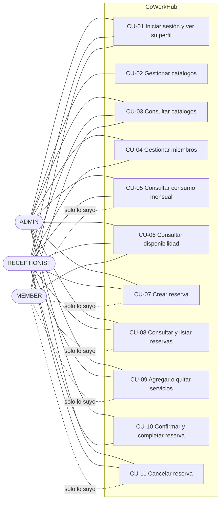
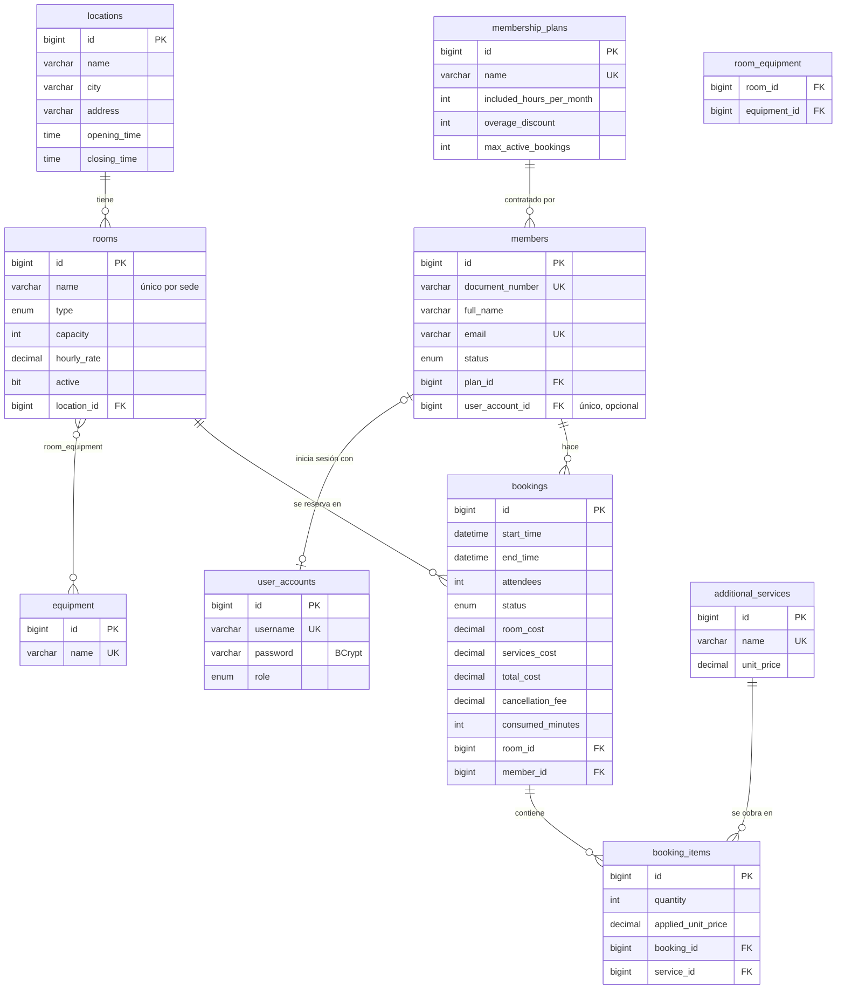

# CoWorkHub — Documento de análisis

API REST con Spring Boot para una red de coworking: evita reservas duplicadas, controla las
horas que consume cada miembro, cobra las cancelaciones con una sola regla y limita a cada
usuario a lo que le corresponde.

Este documento describe el sistema **tal como está implementado**. Cada decisión que el
enunciado deja abierta está en la sección 5.

---

## 1. Actores y casos de uso

| Actor | Quién es | Qué puede hacer |
|---|---|---|
| `ADMIN` | Administrador del coworking | Todo. Es el único que crea, modifica o elimina catálogos (sedes, salas, equipamiento, servicios y planes). |
| `RECEPTIONIST` | Personal de recepción | Gestiona los miembros y todas las reservas. Consulta los catálogos. |
| `MEMBER` | Cliente con un plan de membresía | Consulta catálogos y disponibilidad. Crea, ve, modifica y cancela **solo sus** reservas, y ve **solo su** ficha y su consumo. |

| Caso de uso | Descripción breve |
|---|---|
| CU-01 Iniciar sesión | El usuario envía usuario y contraseña y recibe un JWT que vence en 60 min. Con el token consulta su usuario, rol y `miembroId`. |
| CU-02 Gestionar catálogos | El `ADMIN` crea, modifica y elimina sedes, salas (con su equipamiento), equipamiento, servicios adicionales y planes. No se elimina nada en uso. |
| CU-03 Consultar catálogos | Cualquier usuario autenticado lista y consulta los catálogos; las salas se filtran por sede. |
| CU-04 Gestionar miembros | El personal registra un miembro junto con su cuenta, lo lista con filtros, lo actualiza, lo suspende, lo reactiva y lo elimina. |
| CU-05 Consultar consumo | Horas incluidas, usadas, restantes y excedentes de un miembro en un mes. |
| CU-06 Consultar disponibilidad | Salas libres de una sede en una fecha y un rango, con capacidad mínima y equipamiento opcionales. |
| CU-07 Crear reserva | Reserva de una sala con servicios adicionales; el sistema aplica RN-01 a RN-07 y devuelve el costo. |
| CU-08 Consultar reservas | Una reserva por id, o listados por miembro, por sala y fecha, o por estado. |
| CU-09 Servicios de una reserva | Agregar o quitar servicios mientras la reserva está `PENDING`; el costo se recalcula. |
| CU-10 Confirmar y completar | El personal mueve la reserva de `PENDING` a `CONFIRMED` y de `CONFIRMED` a `COMPLETED`. |
| CU-11 Cancelar | Cancela aplicando la política de anticipación y devuelve el cargo. |

## 2. Glosario

| Término | Definición |
|---|---|
| **Reserva** | Uso de una sala por un miembro en un rango de horas de un mismo día (de 30 min a 8 h, en múltiplos de 30 min), con sus servicios adicionales, su costo y un estado (`PENDING`, `CONFIRMED`, `COMPLETED` o `CANCELLED`). Ocupa la sala mientras está `PENDING` o `CONFIRMED`. |
| **Plan** | Membresía que contrata el miembro. Define las horas incluidas al mes, el descuento sobre las horas excedentes y el máximo de reservas activas futuras. |
| **Horas incluidas** | Horas de sala que el plan cubre cada mes calendario sin costo. Se consumen con las reservas cuyo inicio cae en ese mes, en el orden en que se crean. |
| **Horas excedentes** | Horas de una reserva que ya no caben en las horas incluidas del mes. Se cobran a `tarifa por hora × (1 − descuento del plan)`. |
| **Solapamiento** | Dos reservas activas de la misma sala se solapan si una empieza antes de que la otra termine y termina después de que la otra empieza. Si una termina justo cuando empieza la otra, **no** se solapan. |
| **Cargo por cancelación** | Lo que se cobra al cancelar: 0 con 24 h o más de anticipación (y se devuelven las horas); el 50 % del costo de la sala entre 24 h y 2 h (y las horas no se devuelven). Con menos de 2 h, o si ya empezó, no se puede cancelar. |

## 3. Modelo de dominio

### Diagrama entidad-relación

Restricciones únicas: `members.document_number`, `members.email`, `members.user_account_id`,
`user_accounts.username`, `rooms (location_id, name)`, `equipment.name`,
`additional_services.name`, `membership_plans.name` y `booking_items (booking_id, service_id)`.
Todas las columnas obligatorias son `NOT NULL`. El dinero es `DECIMAL(12,2)` (`BigDecimal`) y
los enumerados se guardan como texto (`@Enumerated(STRING)`).

### Justificación de cada relación

| Relación | Lado dueño | Navegación | fetch | cascade | Por qué |
|---|---|---|---|---|---|
| `Room` → `Location` (N:1) | `Room.location` (FK `location_id`) | Unidireccional | `LAZY` | ninguno | La FK vive en `rooms`. Las salas de una sede siempre se piden filtradas y ordenadas con el repositorio, así que la sede no necesita su colección. Borrar una sala no debe borrar la sede. |
| `Room` ↔ `Equipment` (N:N) | `Room.equipment` (`@JoinTable room_equipment`) | Unidireccional | `LAZY` | ninguno | Es la sala la que "tiene" equipamiento y la que lo edita. El equipamiento es un catálogo compartido: no se crea ni se borra con la sala. Es un `Set` para poder traerlo con `@EntityGraph` junto a la sede sin `MultipleBagFetchException`. |
| `Member` → `MembershipPlan` (N:1) | `Member.plan` (FK `plan_id`) | Unidireccional | `LAZY` | ninguno | Muchos miembros por plan; el plan no necesita la lista (para RN-12 basta `existsByPlanId`). |
| `Member` ↔ `UserAccount` (0..1 : 0..1) | `Member.userAccount` (FK `user_account_id`, única) | Unidireccional | `LAZY` | `PERSIST` | Miembro y cuenta se crean juntos en `POST /api/miembros`. Un miembro puede no tener cuenta, y `ADMIN`/`RECEPTIONIST` tienen cuenta pero no son miembros, por eso la FK es opcional y está en `members`. No hay lado inverso: un `@OneToOne` inverso no se puede cargar `LAZY` en Hibernate y agregaría una consulta por cuenta; el miembro de una cuenta se busca con `findByUserAccountUsername`. Sin `REMOVE`: el servicio borra la cuenta explícitamente. |
| `Booking` → `Room` y `Booking` → `Member` (N:1) | `Booking.room`, `Booking.member` | Unidireccional | `LAZY` | ninguno | Muchas reservas por sala y por miembro. Una reserva no crea ni borra salas ni miembros. Los listados las traen con `@EntityGraph`. |
| `Booking` → `BookingItem` (1:N, composición) | `BookingItem.booking` (FK `booking_id`); `Booking.items` es `mappedBy` | Bidireccional | `LAZY` | `ALL` + `orphanRemoval` | El detalle **pertenece** a la reserva (rombo negro): se guarda con ella y, si se quita de la lista, se borra de la base (RF-06). Es la única relación con `CascadeType.ALL`. |
| `BookingItem` → `AdditionalService` (N:1) | `BookingItem.service` (FK `service_id`) | Unidireccional | `LAZY` | ninguno | El servicio es catálogo. `BookingItem` guarda su propio `appliedUnitPrice`, así que cambiar el precio no altera reservas existentes (RN-07). |

Todas las relaciones a uno se declaran `LAZY` a mano (en JPA son `EAGER` por defecto) y las
colecciones son `LAZY`. Como la API devuelve DTO (nunca entidades), no hay referencias
circulares en el JSON, y como `spring.jpa.open-in-view=false`, lo que un DTO necesita se carga
dentro del servicio con `@EntityGraph`: no hay `LazyInitializationException` ni N+1.

## 4. Matriz de trazabilidad

| RF | Reglas | Endpoint(s) | Implementación |
|---|---|---|---|
| RF-01 Catálogos | RN-11, RN-12, RN-13 | `GET/POST /api/{sedes,salas,equipamientos,servicios-adicionales,planes}`, `GET/PUT/DELETE …/{id}` | `ControladorSedes`, `ControladorSalas`, `ControladorEquipamientos`, `ControladorServiciosAdicionales`, `ControladorPlanes` → `ServicioSedesImpl`, `ServicioSalasImpl`, `ServicioEquipamientosImpl`, `ServicioServiciosAdicionalesImpl`, `ServicioPlanesImpl` |
| RF-02 Miembros | RN-05, RN-11, RN-12, RN-13 | `GET /api/miembros?nombre=&estado=`, `GET/PUT/DELETE /api/miembros/{id}`, `POST /api/miembros`, `PATCH …/suspender`, `PATCH …/activar` | `ControladorMiembros` → `ServicioMiembrosImpl` |
| RF-03 Disponibilidad | RN-01, RN-03, RN-04 | `GET /api/disponibilidad?sedeId=&fecha=&horaInicio=&horaFin=&capacidadMinima=&equipamientoIds=` | `ControladorDisponibilidad` → `ServicioDisponibilidadImpl` → `RoomRepository.findAvailable` |
| RF-04 Crear reserva | RN-01 a RN-07, RN-13 | `POST /api/reservas` | `ControladorReservas` → `ServicioReservasImpl.crear` + `CalculadoraCostoReserva` |
| RF-05 Consultar reservas | RN-13 | `GET /api/reservas/{id}`, `GET /api/reservas?miembroId=` · `?salaId=&fecha=` · `?estado=` | `ServicioReservasImpl.buscar`, `listar` |
| RF-06 Servicios de una reserva | RN-07, RN-10, RN-13 | `POST /api/reservas/{id}/servicios`, `DELETE /api/reservas/{id}/servicios/{servicioId}` | `ServicioReservasImpl.agregarServicio`, `quitarServicio` |
| RF-07 Confirmar | RN-09, RN-13 | `POST /api/reservas/{id}/confirmar` | `ServicioReservasImpl.confirmar` |
| RF-08 Cancelar | RN-08, RN-09, RN-13 | `POST /api/reservas/{id}/cancelar` | `ServicioReservasImpl.cancelar` + `CalculadoraCostoReserva.cargoCancelacionTardia` |
| RF-09 Completar | RN-09, RN-13 | `POST /api/reservas/{id}/completar` | `ServicioReservasImpl.completar` |
| RF-10 Consumo mensual | RN-07, RN-08, RN-13 | `GET /api/miembros/{id}/consumo?mes=yyyy-MM` | `ServicioConsumoImpl` |
| RF-11 Login | RN-13 | `POST /auth/login` | `ControladorAutenticacion` → `ServicioAutenticacionImpl` + `UtilJwt` |
| RF-12 JWT y permisos | RN-13 | Todos salvo los públicos | `ConfiguracionSeguridad`, `FiltroAutenticacionJwt`, `Permisos`, `@PreAuthorize` |
| RF-13 Swagger | — | `/doc/swagger-ui.html`, `/v3/api-docs` | `ConfiguracionOpenApi`, `@Tag`, `@Operation`, `@Schema` |
| RF-14 Perfil | RN-13 | `GET /auth/perfil` | `ControladorAutenticacion.perfil` |
| RF-15 Salud | — | `GET /actuator/health` | Spring Boot Actuator |

### Dónde vive y cómo se prueba cada regla

Todas las reglas están en la capa de negocio (`negocio/service`). Las pruebas son las de
`pruebas/escenarios.py` (y la colección `docs/coworkhub.postman_collection.json`); los
resultados están en `docs/resultados-pruebas.md`.

| Regla | Implementación | Prueba |
|---|---|---|
| RN-01 | `ServicioReservasImpl.validarSinCruce` + `RoomRepository.findForBooking` (bloqueo) | E2, E3, E13 (6 simultáneas) |
| RN-02 | `ServicioReservasImpl.validarDuracion` | E4a, "más de 8 horas", "cruza la medianoche" |
| RN-03 | `ServicioReservasImpl.validarHorario` | E4b, "en el pasado", "menos de 1 h" |
| RN-04 | `ServicioReservasImpl.validarSala` | "sala inactiva", "asistentes sobre la capacidad" |
| RN-05 | `ServicioReservasImpl.validarMiembroActivo` | "miembro suspendido" |
| RN-06 | `ServicioReservasImpl.validarLimiteDelPlan` | "Luis ya tiene 2 activas" |
| RN-07 | `CalculadoraCostoReserva.costoSala` y `costoServicios` | E1, "8 h cubiertas", "2 excedentes = 54.000", "conserva el precio", `CalculadoraCostoReservaTest` |
| RN-08 | `ServicioReservasImpl.cancelar` | E5, E6, E7, "24 h exactas", "2 h exactas" |
| RN-09 | `ServicioReservasImpl.exigirEstado` y `cancelar` | E8, "completar una PENDING", "confirmar" y "completar" |
| RN-10 | `ServicioReservasImpl.exigirPendienteParaServicios` | "agregar servicio a una CONFIRMED" |
| RN-11 | `Validaciones.exigirUnico` en cada servicio + restricciones `UNIQUE` | "email con otras mayúsculas", "documento repetido", "sala repetida en la sede" |
| RN-12 | `Validaciones.exigirSinUso` en cada `eliminar` | E11, "plan con miembros", "miembro con reservas", "sede con salas" |
| RN-13 | `ConfiguracionSeguridad` (URL) + `@PreAuthorize` + `Permisos` | E9, E10, carpeta "3. Permisos" |

### Quién puede hacer qué (RN-13)

| Operación | `ADMIN` | `RECEPTIONIST` | `MEMBER` |
|---|---|---|---|
| Leer catálogos y disponibilidad | ✅ | ✅ | ✅ |
| Crear, modificar o eliminar catálogos | ✅ | `403` | `403` |
| Listar, registrar, actualizar, suspender, activar o eliminar miembros | ✅ | ✅ | `403` |
| Ver la ficha o el consumo de un miembro | ✅ | ✅ | Solo el suyo |
| Crear una reserva | ✅ | ✅ | Solo a su nombre |
| Ver una reserva, cambiar sus servicios o cancelarla | ✅ | ✅ | Solo las suyas |
| Listar reservas por miembro | ✅ | ✅ | Solo con su `miembroId` |
| Listar por sala y fecha o por estado; confirmar; completar | ✅ | ✅ | `403` |

## 5. Supuestos y decisiones

| # | Ambigüedad | Decisión |
|---|---|---|
| S-01 | RN-03 y RN-08 dependen de "ahora" | "Ahora" sale de un bean `Clock` inyectable. `coworkhub.reloj.fijo` lo congela: acepta `2030-06-03T08:00:00` o solo una hora (`08:00` = hoy a esa hora, coherente con las fechas de `import.sql`). Vacío, se usa la hora real. |
| S-02 | ¿Qué mes cuenta para el consumo? | El mes calendario del **inicio** de la reserva. |
| S-03 | ¿Cómo se "devuelven las horas"? | `Booking` tiene un atributo extra, `consumedMinutes`: los minutos del plan que consumió. El consumo del mes es su suma. Sin él no se distinguiría una cancelación tardía cubierta por el plan (cargo 0, horas no devueltas) de una a tiempo. |
| S-04 | Cancelar | Con 24 h o más: `consumedMinutes = 0`, cargo 0. Entre 24 h y 2 h: cargo = 50 % de `roomCost` (que ya excluye las horas cubiertas por el plan) y las horas **no** se devuelven. En los dos casos `totalCost` pasa a ser el cargo. |
| S-05 | Casos límite de RN-08 | 24 h exactas → sin cargo. 2 h exactas → se puede cancelar, con cargo. Menos de 2 h, o ya iniciada → `409`. |
| S-06 | "Al menos 1 h de anticipación" (RN-03) | Se acepta una reserva que empieza exactamente 1 h después de ahora. |
| S-07 | "Reservas activas futuras" (RN-06) | `PENDING` o `CONFIRMED` con inicio posterior a ahora. |
| S-08 | Agregar un servicio que ya está en la reserva | Suma la cantidad y conserva el precio con el que se agregó la primera vez (hay una restricción única por reserva y servicio). |
| S-09 | Cambiar el precio de un servicio | No afecta reservas existentes: cada detalle guarda `appliedUnitPrice`. |
| S-10 | Confirmar y completar | Confirmar exige `PENDING`; completar exige `CONFIRMED`. No se revalidan horarios ni se exige que la reserva haya terminado. |
| S-11 | Eliminar con datos en uso (RN-12) | Sala con reservas (aunque sean pasadas) → `409`, con la sugerencia de desactivarla, para no perder el historial. Igual para sede con salas, plan con miembros, miembro con reservas, equipamiento asignado a una sala y servicio usado en alguna reserva. |
| S-12 | Eliminar un miembro sin reservas | Se borra también su cuenta. |
| S-13 | Unicidad del email (RN-11) | Sin distinguir mayúsculas: se guarda en minúsculas. Los nombres de catálogos y de sala también se comparan sin distinguir mayúsculas. |
| S-14 | Concurrencia (RN-01) | Al crear una reserva se bloquea la fila de la sala (`PESSIMISTIC_WRITE`, `SELECT … FOR UPDATE`) hasta el final de la transacción, con aislamiento `READ_COMMITTED`. Con el `REPEATABLE READ` por defecto de MySQL, la segunda transacción no vería la reserva que la primera acaba de confirmar. Probado con 6 solicitudes simultáneas: una `201` y cinco `409`. |
| S-15 | `400` frente a `409` | Falta un dato o tiene formato inválido → `400`. Se viola una regla de negocio o hay un duplicado → `409`. |
| S-16 | Un `MEMBER` pide una reserva que no existe | `403`, igual que si fuera de otro: así no puede averiguar qué ids existen. |
| S-17 | Listar reservas | Exactamente un filtro (`miembroId`, `salaId` + `fecha`, o `estado`); sin filtro o con varios → `400`. |
| S-18 | Disponibilidad fuera del horario de la sede | `409 RN-03`, para que quede claro por qué no hay salas. |
| S-19 | Consumo sin `mes` | Se usa el mes actual. |
| S-20 | Personal | Las cuentas `ADMIN` y `RECEPTIONIST` vienen de `import.sql`; gestionarlas por API queda fuera de alcance. |
| S-21 | Contraseñas | De 6 a 72 caracteres, guardadas con BCrypt. El login responde lo mismo si el usuario no existe o si la contraseña es incorrecta. |
| S-22 | `DELETE` | Responde `200` sin cuerpo (también el de quitar un servicio; el costo recalculado se ve con `GET`). |
| S-23 | Horario de la sede | Se compara la hora del día: inicio ≥ apertura y fin ≤ cierre. |
| S-24 | Fechas | ISO-8601 sin zona (`2026-12-01T10:00:00`), en la zona horaria del servidor. |

## 6. Fuera de alcance

- Pagos en línea, facturación y recaudo de los cargos (el sistema solo calcula montos).
- Notificaciones por correo o mensajes.
- Interfaz gráfica.
- Gestión de cuentas de personal por API.
- Recuperación de contraseña, cambio de contraseña y renovación de tokens (*refresh tokens*).
- Reservas recurrentes y listas de espera.

## 7. Decisiones técnicas

| Tema | Decisión | Motivo |
|---|---|---|
| Nombres | Modelo de datos en inglés (entidades, atributos, tablas y repositorios), como exige el enunciado. API en español (rutas, parámetros, JSON) y clases de las capas en español (`ServicioReservas`, `ControladorReservas`, `SolicitudReserva`), como pide la rúbrica. | Cada regla se aplica a una capa completa, así que no hay mezclas dentro de una misma capa. |
| Capas | `presentacion` (`controlador`, `dto`, `excepcion`) → `negocio` (`model`, `service`, `excepcion`) → `persistence` (`repository`); `config` y `jwt` transversales. | Ningún controlador usa un repositorio y ningún servicio conoce HTTP. |
| Servicios | Interfaz + implementación, inyección por constructor, `@Transactional` en escrituras y `readOnly` en lecturas. | Módulos 02 y 05. |
| Costos | Bean `CalculadoraCostoReserva` (`@Component`), sin acceso a la base. | Las fórmulas de dinero en un solo lugar, fáciles de probar (`CalculadoraCostoReservaTest`). |
| DTO | `record` de entrada validados con `@Valid` y `record` de salida. Ninguna entidad sale de la API. | El cliente no puede enviar `id`, `estado` ni costos, y el JSON no tiene ciclos. |
| N+1 | `@EntityGraph` en todos los listados y `open-in-view=false`. | Cada listado es una sola consulta (comprobado con `show-sql`). |
| Errores | Excepciones propias en `negocio/excepcion` y un único `@RestControllerAdvice`. Los filtros de seguridad escriben el mismo cuerpo. | Todo error responde `{"error", "codigo", "timestamp"}`, incluidos JSON roto, ruta inexistente, método no permitido, `401` y `403`. |
| Seguridad | Primero Basic Auth (commit propio) y después JWT *stateless* (jjwt, HS512, 60 min). Catálogos por URL; rol y dueño del recurso con `@PreAuthorize` y el bean `@permisos`. | Lo que depende de quién es el dueño no se puede decidir solo por URL. |
| Relojes | `@Primary Clock reloj` (de negocio, congelable) y `@Qualifier("relojReal") Clock` para el JWT. | Un token debe vencer en tiempo real aunque el reloj de negocio esté congelado. |
| Configuración | `@Value` para el reloj y el JWT; `@PostConstruct` que valida el reloj fijo y el largo de la clave al arrancar. | Una configuración inválida detiene la aplicación con un mensaje claro. |
| Datos de prueba | `import.sql` con fechas relativas a hoy (`CURDATE() + INTERVAL n DAY`) y `ddl-auto=create`. | Las reservas futuras siguen siendo futuras y cada arranque empieza con los mismos datos. |
